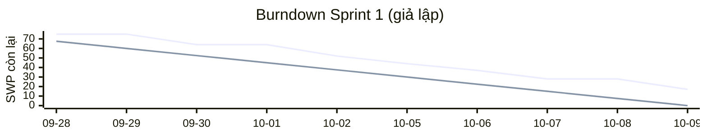

# Báo cáo tiến độ — Sprint 1

Iteration "Sprint 1" trên GitHub Project, giả lập từ 2026-09-28 đến 2026-10-09. Báo cáo ghi trạng thái cuối ngày 2026-10-09 và được viết ngày 2026-10-16. Số liệu là số giả lập: ngày một issue chuyển Done là ngày giả lập, còn ngày đóng issue trên GitHub là ngày ghi dữ liệu. Sprint 2 chưa được giả lập: các issue Sprint 2 và Sprint 3 trên Project đều đang Todo.

Kế hoạch Sprint 1 là 17 issue lá, 75 SWP, 225 giờ. Kết quả: 12 issue Done, 58 SWP (tức 77,3 % kế hoạch), 174 giờ. Năm issue còn lại chưa xong (17 SWP) vẫn thuộc Iteration Sprint 1; việc làm tiếp ở Sprint 2 được viết thành hành động ở mục rủi ro.

## Trạng thái

Bảng dưới đếm mọi issue lá của Project (không đếm epic và issue cha, vì cha chỉ là tổng của con), đọc ngược từ Project sau khi ghi trường.

| Trạng thái | Số issue | Tổng SWP | Ghi chú |
|---|---:|---:|---|
| Todo | 188 | 985 | 157 lá Phase 1 chưa xếp sprint, 4 lá `phase-2` không có Iteration, 27 lá đã xếp Sprint 2 hoặc Sprint 3 (kế hoạch, chưa giả lập) |
| In Progress | 2 | 8 | Cả hai thuộc Sprint 1: #54 (E04-I07), #212 (E09-I01-S01) |
| Blocked | 3 | 9 | Cả ba thuộc Sprint 1, chờ khách trả lời: #39 (E02-I06), #107 (E10-I08), #234 (E09-I09-S01) |
| Done | 12 | 58 | Toàn bộ thuộc Sprint 1 |
| **Tổng** | 205 | 1060 |  |

Riêng trong Sprint 1:

| Trạng thái trong Sprint 1 | Số lá | SWP | Giờ |
|---|---:|---:|---:|
| Done | 12 | 58 | 174 |
| In Progress | 2 | 8 | 24 |
| Blocked | 3 | 9 | 27 |
| **Kế hoạch Sprint 1** | 17 | 75 | 225 |

## Burndown Sprint 1

Bảng theo ngày dưới đây là số SWP còn lại cuối mỗi ngày; cột "Đường lý tưởng" là đường giảm đều từ kế hoạch về 0 trong mười ngày làm việc.

| Ngày | Đường lý tưởng | SWP còn lại | Sự kiện |
|---|---:|---:|---|
| 2026-09-28 | 67.5 | 75 | Sprint planning: 17 lá, 75 SWP / 225 giờ; ưu tiên lõi BE #10 (E09): BE-1 bắt đầu #132 (E01-I01-S01); FE-1 bắt đầu #185 (E06-I06-S01) theo spec SCR010 (dữ liệu giả, chưa nối API); BrSE soạn gói câu hỏi #33 (E01-I20), #39 (E02-I06), #234 (E09-I09-S01); QA-1 không có lá nào mở được trong Sprint 1 |
| 2026-09-29 | 60.0 | 75 | BrSE gửi khách #33 (E01-I20) (tài khoản AWS, lưu giữ, BCP) và #39 (E02-I06) (IdP doanh nghiệp, claim MFA, vai trò); BE-2 bắt đầu #26 (E01-I13) trên nhánh khung module, merge sau #132 (E01-I01-S01) |
| 2026-09-30 | 52.5 | 64 | #132 (E01-I01-S01) Done, #185 (E06-I06-S01) Done; Trưởng nhóm duyệt keigo, BrSE gửi khách gói câu hỏi pháp chế và vận tải #234 (E09-I09-S01) (JP-13, JP-14), hạn trả lời đề nghị 2026-10-06 |
| 2026-10-01 | 45.0 | 64 | BrSE gửi khách #54 (E04-I07) (danh mục tình trạng bao bì) và #107 (E10-I08) (hạn nhắc ca thiếu file, D-11); BE-1 bắt đầu #24 (E01-I11); FE-1 bắt đầu #32 (E01-I19) trên nhánh khung |
| 2026-10-02 | 37.5 | 52 | #24 (E01-I11) Done, #26 (E01-I13) Done: hai khoá inventory.receiving.packaging-conditions và temperature.logger.missing-shift-reminder nạp ở trạng thái trống có chủ ý, chặn khởi động prod và nằm trong danh sách kiểm phát hành |
| 2026-10-05 | 30.0 | 44 | #32 (E01-I19) Done (merge sau #24 (E01-I11)), #235 (E09-I09-S02) Done (mẫu hồ sơ bằng chứng, mọi dòng ghi chưa xác thực); Khách trả lời gói #33 (E01-I20) (giả lập); BE-1 bắt đầu #27 (E01-I14), BE-2 bắt đầu #133 (E01-I01-S02), FE-1 bắt đầu #142 (E02-I01-S03) |
| 2026-10-06 | 22.5 | 37 | #133 (E01-I01-S02) Done; #33 (E01-I20) Done (câu trả lời ghi vào sổ quyết định); Hạn trả lời đề nghị của #234 (E09-I09-S01) đã qua, BrSE nhắc khách |
| 2026-10-07 | 15.0 | 28 | Lệch kế hoạch: ngày 8 vẫn chưa có trả lời JP-13 / JP-14 (pháp chế khách báo cần thêm thời gian) → #234 (E09-I09-S01) Blocked; CNTT khách báo chưa chọn xong IdP doanh nghiệp (Q17) → #39 (E02-I06) Blocked; #140 (E02-I01-S01) (đã xếp Sprint 2) sẽ chạy với IdP thử; #27 (E01-I14) Done, #142 (E02-I01-S03) Done (màn SCR001 chạy trên mock của API phiên); BE-1 bắt đầu #212 (E09-I01-S01): dựng bảng, vòng đời, tra cứu với tham số JP-11 / JP-12; giữ lại hai cột tham số nghỉ JP-13 và cơ sở làm thêm JP-14; BE-2 bắt đầu #141 (E02-I01-S02), FE-1 bắt đầu #201 (E07-I07-S01) |
| 2026-10-08 | 7.5 | 28 | Khách trả lời một phần #54 (E04-I07): phần mã lý do có trả lời, danh mục tình trạng bao bì còn chờ bộ phận chất lượng → giữ In Progress |
| 2026-10-09 | 0.0 | 17 | #141 (E02-I01-S02) Done (API phiên, chọn nơi lưu phiên), #201 (E07-I07-S01) Done; #107 (E10-I08) chưa có trả lời sau 6 ngày làm việc → Blocked; Sprint review: 58 / 75 SWP Done (77,3 %); #212 (E09-I01-S01) In Progress ~60 %; 5 lá dở giữ Iteration Sprint 1, làm tiếp từ Sprint 2 (2026-10-12); phần còn lại của chuỗi đăng nhập (#140 (E02-I01-S01), #143 (E02-I01-S04)) và CI (#18 (E01-I05)) đã xếp Sprint 2 |

**Lệch ở đâu, vì sao.** Đường thật nằm trên đường lý tưởng suốt sprint và kết thúc ở 17 SWP còn lại thay vì 0. Ba lý do, đều có ngày:

- Các ngày 2026-09-28, 2026-09-29 và 2026-10-01 đường đi ngang: chuỗi lõi BE bắt đầu bằng khung module và các issue sau phải chờ nó merge, nên mỗi lần chỉ có thêm việc được bắt đầu chứ chưa có gì kết thúc. Ngày 2026-09-30 mới xong hai issue đầu tiên, còn lại 64 SWP.
- Ngày 2026-10-07 (ngày làm việc thứ tám): gói câu hỏi giờ lái (JP-13, JP-14) gửi khách từ 2026-09-30 với hạn đề nghị 2026-10-06 vẫn chưa có trả lời, nên #234 (E09-I09-S01) chuyển Blocked; cùng ngày CNTT khách báo chưa chọn xong nhà cung cấp danh tính, nên #39 (E02-I06) chuyển Blocked. Ngày 2026-10-08 đường đi ngang vì khách mới trả lời một phần #54 (E04-I07).
- Ngày 2026-10-09: #107 (E10-I08) chưa có trả lời sau sáu ngày làm việc, thành Blocked. #212 (E09-I01-S01) dừng ở khoảng 60 % vì hai nhóm cột phụ thuộc câu trả lời JP-13 và JP-14.

Cả năm issue dở đều dở vì chờ khách chứ không vì đội làm chậm. Một điểm cần nói thẳng: **Sprint 1 không có lát dọc mới** (màn → API → DB) nào xong. Chủ dự án chọn đặt lõi BE của luật giờ lái xe tải 2024 lên trước, BE-1 dùng hết 60 giờ cho chuỗi đó, mà mọi lát dọc đều cần BE-1; phần đăng nhập chỉ xong API phiên (#141 (E02-I01-S02)) và màn đăng nhập chạy trên dữ liệu giả (#142 (E02-I01-S03)).

## Rủi ro trễ

Các hành động và ngày dưới đây là kế hoạch lập ở cuối Sprint 1. Mốc dự án lấy từ LAB-1 v1 (2026-09-10): UAT bắt đầu tuần 28, tức 2027-04-12 (tuần 1 tính từ 2026-10-05), go-live cố định 2027-06-01. Sprint 2 kết thúc ngày 2026-10-25.

Dòng nào gắn mã (JP-13, SCR001 Q1, khoá cấu hình…) là rủi ro chờ câu trả lời của khách; ba dòng về năng lực BE, lát dọc và QA không có mã vì số được tính từ giờ còn lại theo vai trên Project và lịch của bản LAB-1 v1, không phụ thuộc câu hỏi nào.

| Rủi ro | Issue | Ảnh hưởng tới mốc nào | Hành động | Ai làm, khi nào |
|---|---|---|---|---|
| Hai BE không kịp mốc: giờ BE còn lại của Phase 1 là 1935, cần 16,1 sprint (hai BE × 60 giờ / sprint) mà trước UAT chỉ còn 13 sprint, thiếu khoảng 375 giờ BE (3,1 sprint). Giữ nhãn vai như hiện nay thì BE-1 xong khoảng 2027-06-18, sau go-live. | Mọi lá BE Phase 1 chưa xếp sprint; đại diện: #212 (E09-I01-S01), #158 (E04-I04-S01), #268 (E13-I02-S01) | Kết thúc Sprint 2 (2026-10-25) là hạn chốt phương án; UAT 2027-04-12 và go-live 2027-06-01 (LAB-1 v1, 2026-09-10) là mốc bị đe doạ | Ba phương án: (a) thêm một BE khoảng 6–7 sprint; (b) cắt hoặc dời khoảng 125 SWP việc BE khỏi Phase 1; (c) dời mốc UAT. Khuyến nghị: trình khách cả ba ngay, nghiêng về (a) vì (b) mất phạm vi và (c) chạm ngày go-live cố định | PM và BrSE dựng ba phương án kèm số liệu, gửi khách trước 2026-10-23; chủ dự án chọn phương án trước khi Sprint 2 kết thúc (2026-10-25) |
| Câu hỏi giờ lái JP-13 (nghỉ, lái liên tục, bình quân) và JP-14 (làm thêm giờ) chưa có trả lời: gửi 2026-09-30, hạn đề nghị 2026-10-06 đã qua; lá dựng bảng luật chỉ làm được phần JP-11 / JP-12 (khoảng 60 %), còn hai nhóm cột tham số chờ. | #234 (E09-I09-S01), #212 (E09-I01-S01), #218 (E09-I03-S02) | Kết thúc Sprint 2 (2026-10-25) cho #212 (E09-I01-S01); #218 (E09-I03-S02) (Sprint 3, bắt đầu 2026-10-26) chỉ chạy khi có JP-13 | Nhắc pháp chế và nhân sự khách (bằng keigo), xin ngày trả lời cụ thể; ghi câu trả lời vào sổ quyết định khi có; BE-1 làm nốt hai nhóm cột ngay khi khách trả lời (đã giữ 6 giờ BE-1 ở Sprint 2). Mã mở: JP-13, JP-14 | BrSE từ 2026-10-12, nhắc mỗi tuần; BE-1 ngay khi có trả lời |
| Khách chưa chọn nhà cung cấp danh tính doanh nghiệp (Q17): CNTT khách báo ngày 2026-10-07 chưa xong; chưa có giá trị claim MFA nên chuỗi đăng nhập chạy với IdP thử. | #39 (E02-I06), #140 (E02-I01-S01), #143 (E02-I01-S04) | Kết thúc Sprint 2 (2026-10-25): đăng nhập là luồng đầu-cuối đầu tiên; sau đó mọi màn cần phân quyền | Xin CNTT khách ngày chốt IdP; trong lúc chờ, làm với IdP thử, issuer và claim MFA là khoá cấu hình; khi khách chốt thì đổi giá trị cấu hình rồi chạy lại kiểm thử đầu-cuối. Mã mở: SCR001 Q1, ADR-006 Q1, ADR-006 Q2 | BrSE từ 2026-10-12; BE-1 làm #140 (E02-I01-S01) trong Sprint 2 |
| Hai khoá cấu hình go-live đang để trống có chủ ý vì khách chưa trả lời: danh mục tình trạng bao bì (`inventory.receiving.packaging-conditions`) và hạn nhắc ca thiếu file nhiệt độ (`temperature.logger.missing-shift-reminder`, D-11). Khoá trống chặn khởi động môi trường prod và nằm trong danh sách kiểm phát hành. | #54 (E04-I07), #107 (E10-I08) | Go-live 2027-06-01 (LAB-1 v1, 2026-09-10): không phát hành được khi hai khoá còn trống | Theo dõi bộ phận chất lượng của khách để có danh mục bao bì (khách đã trả lời một phần ngày 2026-10-08); với hạn nhắc ca thiếu file, nếu khách chưa chốt thì xin quyết định bằng văn bản về cách go-live khi khoá còn trống | BrSE từ 2026-10-12; kiểm lại ở mỗi buổi họp định kỳ với khách |
| Sprint 1 không có lát dọc (màn → API → DB) mới nào xong: chủ dự án đặt lõi BE của luật giờ lái 2024 lên trước, BE-1 dùng hết 60 giờ cho chuỗi đó, mà mọi lát dọc đều cần BE-1. Luồng đầu-cuối đầu tiên là đăng nhập, dự kiến xong ở Sprint 2; nhập kho chưa vừa Sprint 1–3 (chuỗi phụ thuộc cần khoảng 222 giờ BE-1), sớm nhất Sprint 6. | #140 (E02-I01-S01), #158 (E04-I04-S01) | Kết thúc Sprint 2 (2026-10-25) cho buổi demo đầu tiên; nhập kho ảnh hưởng buổi demo nhập kho với khách | Giữ thứ tự đã chốt (lõi giờ lái trước); demo đăng nhập ở cuối Sprint 2; nếu khách cần xem nhập kho sớm thì dành Sprint 4–6 cho chuỗi này | PM xếp lịch demo trước 2026-10-23; chủ dự án quyết nếu muốn đổi thứ tự |
| QA-1 không có lá nào mở được ở Sprint 1 và Sprint 3 (mọi lá QA còn lại phụ thuộc lá BE chưa xong), nên việc kiểm thử dồn về cuối. Giờ QA còn dư nhiều (dư 504 giờ so với 13 sprint) nhưng chỉ khi có việc mở được. | #143 (E02-I01-S04) | UAT 2027-04-12 (LAB-1 v1, 2026-09-10) | Xếp lịch QA theo từng lát dọc ngay khi xong; giữ đệm QA trước UAT | PM, ở mỗi buổi lập kế hoạch sprint (đầu Sprint 2: 2026-10-12) |

Năm issue dở của Sprint 1 giữ Iteration Sprint 1 trên Project (trạng thái In Progress hoặc Blocked); việc làm tiếp ở Sprint 2 chỉ là các hành động sau, không đổi Iteration:

| Issue dở | Vai | SWP / giờ | Trạng thái 2026-10-09 | Hành động từ 2026-10-12 (Sprint 2) | Lý do | Mã câu hỏi mở |
|---|---|---|---|---|---|---|
| #212 (E09-I01-S01) — Bảng phiên bản luật tài xế và tra cứu phiên bản hiệu lực | BE-1 | 5 / 15 | In Progress | BE-1 làm nốt hai cột tham số nghỉ JP-13 và cơ sở làm thêm JP-14 ngay khi khách trả lời; đã giữ 6 giờ BE-1 ở Sprint 2 | Bảng, vòng đời, ràng buộc bốn mắt, hàm tra cứu xong với tham số JP-11 / JP-12 (~60 %); hai nhóm cột phụ thuộc cách hiểu JP-13 / JP-14 chưa được khách xác nhận | JP-13, JP-14 |
| #234 (E09-I09-S01) — Gói câu hỏi pháp chế và vận tải gửi khách | BrSE | 3 / 9 | Blocked | BrSE nhắc pháp chế và nhân sự khách (keigo), xin ngày trả lời cụ thể; ghi câu trả lời vào sổ quyết định khi có | Gửi 2026-09-30, hạn đề nghị 2026-10-06 đã qua, 2026-10-07 vẫn chưa có trả lời | JP-13, JP-14 |
| #39 (E02-I06) — Làm rõ với khách: IdP, vai trò, kiểm toán viên, cách cấp tài khoản | BrSE | 4 / 12 | Blocked | BrSE xin CNTT khách ngày chốt IdP doanh nghiệp (Q17); khi có, chuyển issuer và claim MFA cho #140 (E02-I01-S01) / #143 (E02-I01-S04) (đã xếp Sprint 2, chạy trước với IdP thử) | Gửi 2026-09-29; 2026-10-07 CNTT khách báo chưa chọn xong IdP | SCR001 Q1, ADR-006 Q1, ADR-006 Q2 |
| #54 (E04-I07) — Làm rõ với khách các danh mục và luật còn trống của nhập kho | BrSE | 3 / 9 | In Progress | BrSE theo dõi bộ phận chất lượng của khách để có danh mục 梱包状態, nhập vào khoá cấu hình và gỡ cờ chặn go-live | Khách trả lời một phần ngày 2026-10-08; danh mục tình trạng bao bì còn chờ, khoá vẫn trống | inventory.receiving.packaging-conditions |
| #107 (E10-I08) — Làm rõ với khách: các điểm chặn của nhiệt độ và HACCP | BrSE | 2 / 6 | Blocked | BrSE nhắc khách (chất lượng + CNTT) về hạn nhắc ca thiếu file và giờ ca thật; nếu khách chưa chốt, xin quyết định bằng văn bản về cách go-live khi khoá còn trống | Gửi 2026-10-01, đến 2026-10-09 chưa có trả lời | temperature.logger.missing-shift-reminder, D-11 |

Phần còn lại của chuỗi đăng nhập (#140 (E02-I01-S01) và #143 (E02-I01-S04)) và CI (#18 (E01-I05)) chưa từng thuộc Sprint 1; chúng đã được xếp vào Sprint 2 từ đầu.
